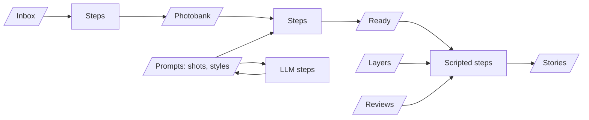

# Rocketbox

Rocketbox handles marketing for small businesses while owners keep doing their craft.

## Product

**Pitch:** We handle marketing for you while you work.

**Loop (once live):**
1. One-time setup — crawl the business website and social presence
2. Owner sends media during the day (Telegram or WhatsApp; more connectors later)
3. Fully automated Instagram publishing — Reels, Stories, and feed posts
4. Owner can delete anything they dislike after it goes live (typically after work)

**Not the homepage story:** Setup/run mechanics stay off the public marketing surface. Ads target specific verticals (barbershops, salons, etc.); the site speaks to “your business.”

**Current go-to-market:** Public CTA is “Get started for free” at `/sign_up` ([signups](/app/controllers/signups_controller.rb)), which starts onboarding in WhatsApp. Public pricing lives at `/pricing` ([tiers](/app/controllers/pricing_controller.rb)); plan CTAs also go to `/sign_up`.

**Proof / examples:** Use-case pages under `/use-cases/:slug` ([registry](/app/controllers/use_cases_controller.rb)), with real barbershop demos reused on the home page.

**SMM media pipeline:** How SMM media gets produced: workflows read media from folders, run it through transformation steps and land the results in folders (Ready by default).

**Folders** ([model](/app/models/folder.rb), browsed at `/app/library/:root(/:child)`): one global table; each folder's `kind` says what it holds: media, prompts or reviews. Top-level folders (Inbox, Photobank, Prompts and Reviews are seeded) hold subfolders one level below of their kind (`inbox/interior`, `photobank/logo`, `prompts/shots`, `prompts/styles`); Reviews holds every review itself. Ready is `photobank/ready` (or `prompts/ready` for prompts), where a step with no output folder lands. Every media, prompt and review is in exactly one folder; workflow folder nodes point at folders, and a folder's page lists the workflows reading and writing it.

**Transformations** ([model](/app/models/transformation.rb), types under [transformation/](/app/models/transformation/)): a named processing step (type, prompt, options, layer steps), owned by one workflow step and edited in the workflow's inspector ([controller](/app/controllers/accounts/transformations_controller.rb)). Its type is picked from the workflow's + Add popover and fixed once created, and says which item kinds it takes and makes (an LLM takes prompts and writes one). Every run is a `TransformationRun` of polymorphic input items and result; a generated media's page links to the step that made it.

**Workflows:** the media pipeline — a graph of folder (media, prompt or review), media and transformation step nodes, typed edges carrying items of one kind, with colored Markdown sticky notes beside them, edited and run on a flow canvas at `/app/workflows` (laid out with dagre in [flow_controller](/app/javascript/controllers/flow_controller.js)); inspired by n8n, ComfyUI, Zapier and friends. A media's page can run it in a workflow starting from its folder. See [WORKFLOWS.md](./docs/WORKFLOWS.md). Given a workflow URL, curl its `.md` first: graph, step settings and runs in one page ([how](./docs/WORKFLOWS.md#reading-a-workflow-agents)).

**Tags** ([model](/app/models/tag.rb), managed in ActiveAdmin): global labels on media, many per media, shown as `#name` pills ([partial](/app/views/accounts/tags/_tag.html.erb)) and edited on the media page. A workflow node's `tag_ids`: a media folder gives only media with all of them, a step sets them on what it makes. A media folder can also filter by `media_type` (images, videos or any), set beside its Take.

**Schedule** ([model](/app/models/rubric.rb), at `/app/schedule`): rubrics, each a recurring series of Instagram stories, reels or feed posts from one media folder on a cron or plain-English schedule (`every weekday at 9am`), colored and previewed on a month calendar. Auto-publish is off by default; when on, each due time publishes the folder's media posted longest ago (or never) as a `RubricPost`, the history of what went out when.

## Production
- URL: https://rocketbox.plus
- Runner: `bin/kamal app exec --reuse "bin/rails runner '...'"` (aliases: `bin/kamal console`, `shell`, `logs`; see [DEPLOY.md](./docs/DEPLOY.md)).

## Dev
- Local: http://localhost:3003 (`bin/dev`)
- Tunnel (public webhooks): https://dev.rocketbox.plus (`make tunnel`)
- Tests mock ffmpeg media rendering; `RENDER_MEDIA=1 bin/rails test` renders for real (CI does).
- Don't use the browser to test changes unless the user explicitly asks.

**No backwards compatibility.** The service is new and still in the making — no active users yet. Prefer deleting and reshaping over redirects, aliases, or dual-path support.

## UI / Tailwind
Prefer built-in scale utilities over arbitrary values (`rounded-[10px]`, `min-w-[10rem]`, `px-[18px]`, …). Use the nearest step (`rounded-lg`, `min-w-40`, `px-4.5`). Keep arbitrary values only when nothing on the scale fits (e.g. mockup micro-type, email `max-w-[600px]`, one-off layout heights).

No CSS transitions on hover (`transition`, `transition-colors`, `duration-*`, …). Hover states change instantly.

## Vocabulary
- **Island** — a standalone content panel, usually styled `rounded-2xl border border-ink-900/10 bg-white p-6`.
- **Rubric** — a recurring series of posts (not a single post); **rubric post** — one post it made.
- Workflow terms (node, step, edge, run, step run): see [WORKFLOWS.md](./docs/WORKFLOWS.md#vocabulary).

# Documentation Index

### [WORKFLOWS.md](./docs/WORKFLOWS.md)
Workflow graphs, the canvas editor, runs and step runs; prior art (n8n, ComfyUI, Zapier).

### [STRIPE.md](./docs/STRIPE.md)
Payments and billing via Stripe.

### [TELEGRAM.md](./docs/TELEGRAM.md)
Telegram bot: inbound media, webhooks, outbound messaging.

### [WHATSAPP.md](./docs/WHATSAPP.md)
WhatsApp Cloud API: inbound media, webhooks, outbound messaging.

### [LOGIN.md](./docs/LOGIN.md)
Authentication and session login.

### [DEPLOY.md](./docs/DEPLOY.md)
How the app is deployed and operated in production.

### [PROMPTS.md](./docs/PROMPTS.md)
LLM prompts: content prompts in workflow steps' transformations; service prompts are constants in code.

### [PRICE_BANDS.md](./docs/PRICE_BANDS.md)
How AI models get their £ / ££ / £££ price band: per-image and per-second cost estimates.

### [ICONS.md](./docs/ICONS.md)
Heroicons: `heroicon "name"` — no variant or size unless needed.
